# VitroLab MX

**Comunidad de casos, reportes de laboratorio y fuentes sobre cultivo in vitro de material vegetal.**

[](https://www.php.net/)
[](https://www.postgresql.org/)
[](https://neon.com/)
[](LICENSE)

## Qué es

VitroLab MX es un portal en español para documentar el **cultivo in vitro de material vegetal**. Reúne:

- **Casos:** especie, explante, desinfección, medio, reguladores, condiciones, protocolo paso a paso, resultados y aprendizajes.
- **Reportes de laboratorio:** ensayos, validaciones, protocolos, diagnósticos y seguimientos con diseño, tratamientos, variables, análisis y limitaciones.
- **Especies e instituciones:** fichas botánicas y directorio de universidades, centros de investigación y laboratorios.
- **Biblioteca y glosario:** repositorios, datasets, manuales y literatura científica, además de un vocabulario común para comparar protocolos.

> **Demo en línea:** <https://lightcoral-hare-545659.hostingersite.com>
> **Repositorio:** <https://github.com/Mikato8/Vitrolab-MX>
>
> Contenido demostrativo: **10 casos, 7 reportes, 24 especies y 32 instituciones**. Las cifras de los casos y reportes demo son ilustrativas y están marcadas como tales.

La verificación es **institucional**: correo de una institución registrada, dominio `.edu.mx` o constancia revisada por el comité. **No se solicita cédula profesional.**

> **Aviso educativo.** El contenido no sustituye asesoría técnica, sanitaria, regulatoria ni legal. Un protocolo publicado no certifica bioseguridad ni eficacia; verifícalo con tu comité y la normativa aplicable.

## Capturas

| Portada | Casos | Caso |
| --- | --- | --- |
| 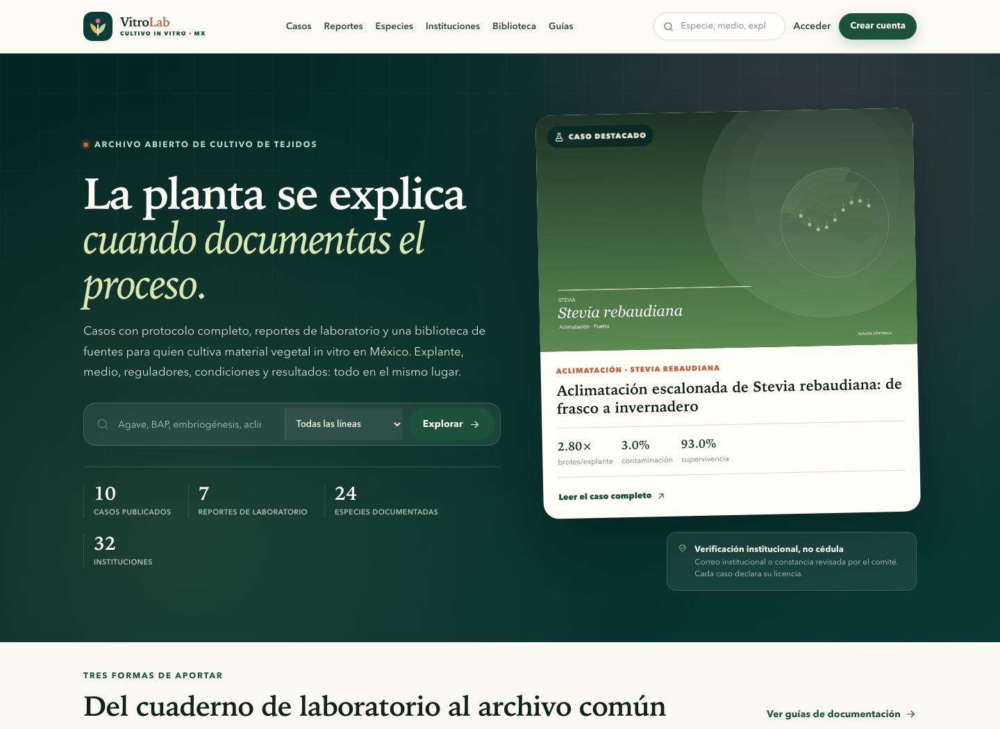 | 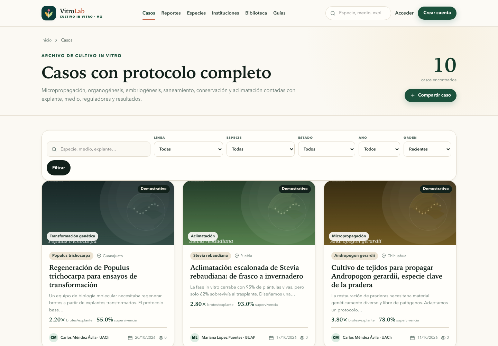 | 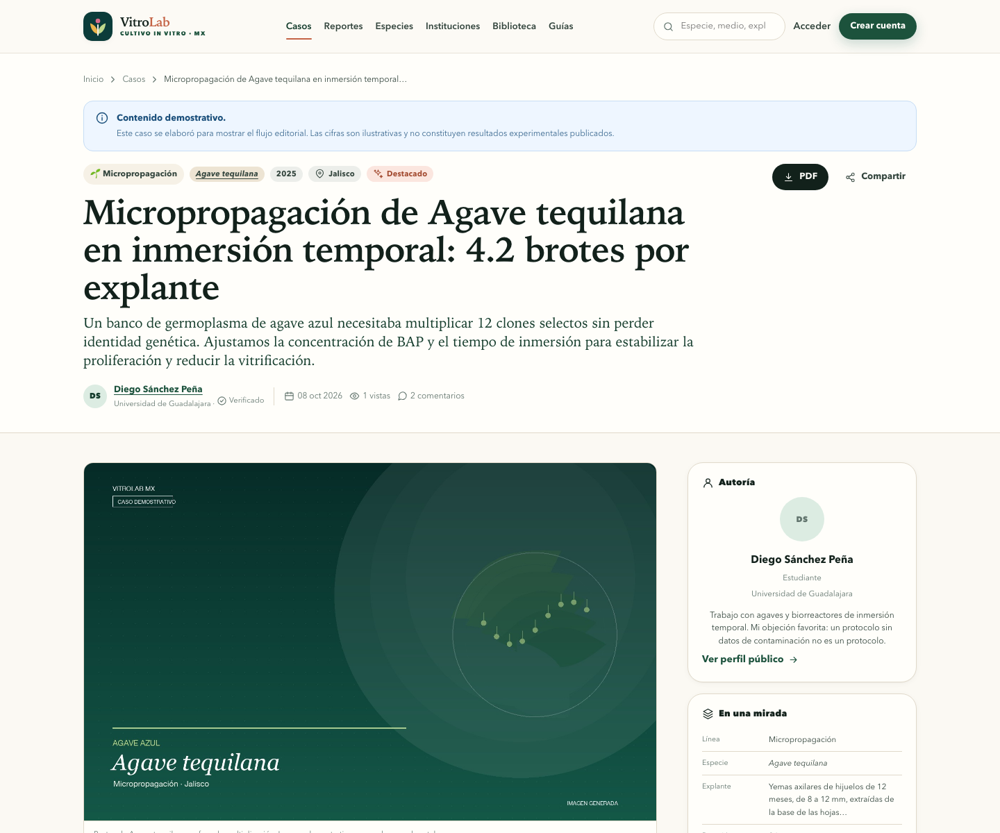 |

| Reportes | Reporte | Especies |
| --- | --- | --- |
| 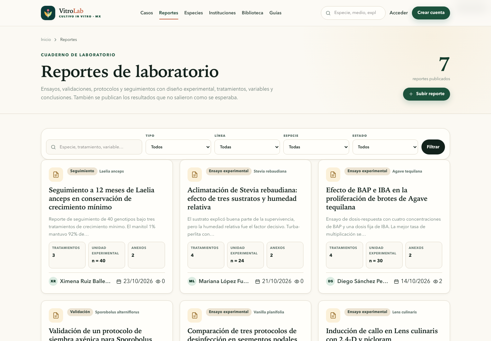 | 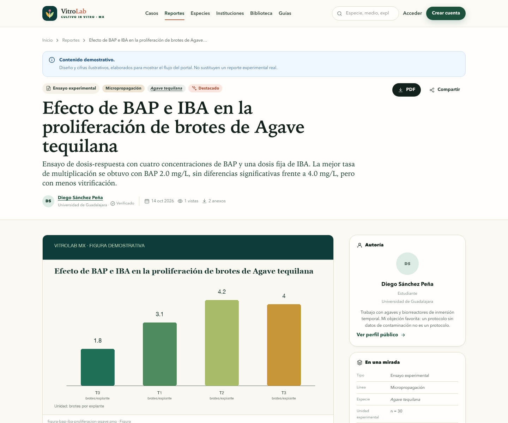 | 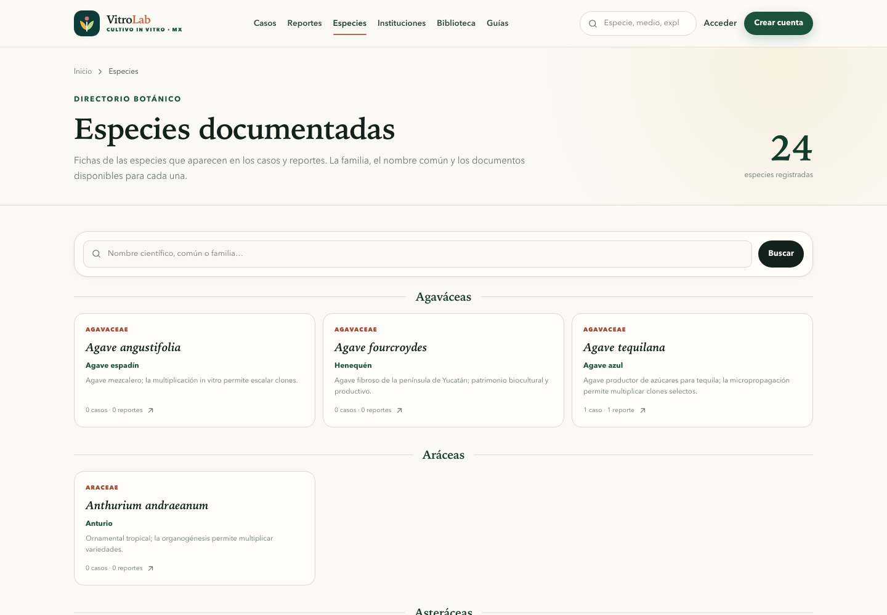 |

| Instituciones | Biblioteca | Móvil |
| --- | --- | --- |
| 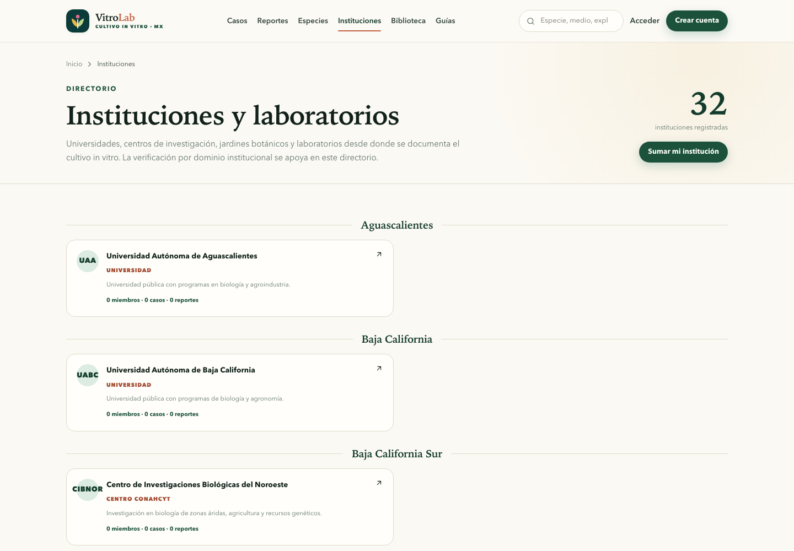 | 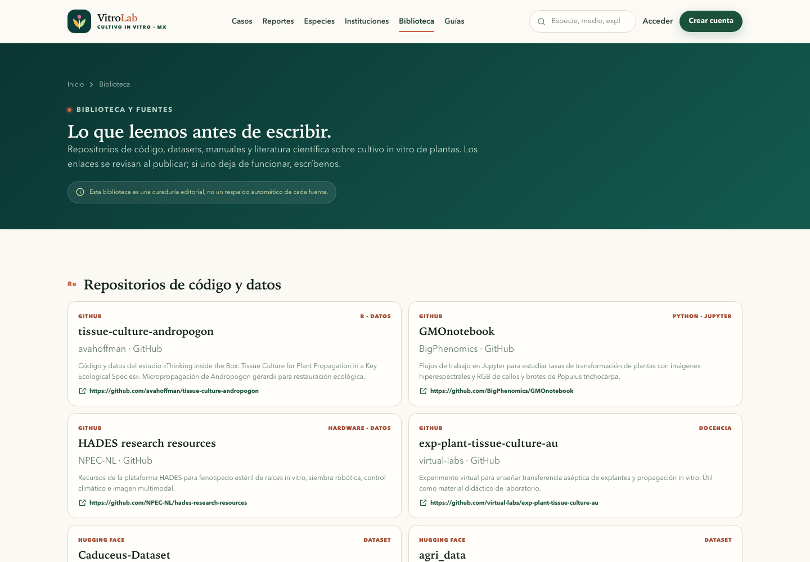 | 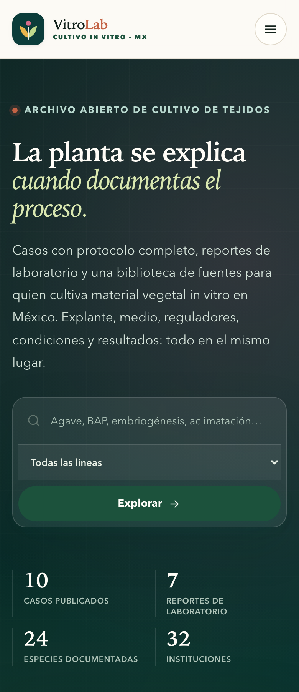 |

| Panel editorial | Formulario de caso |
| --- | --- |
| 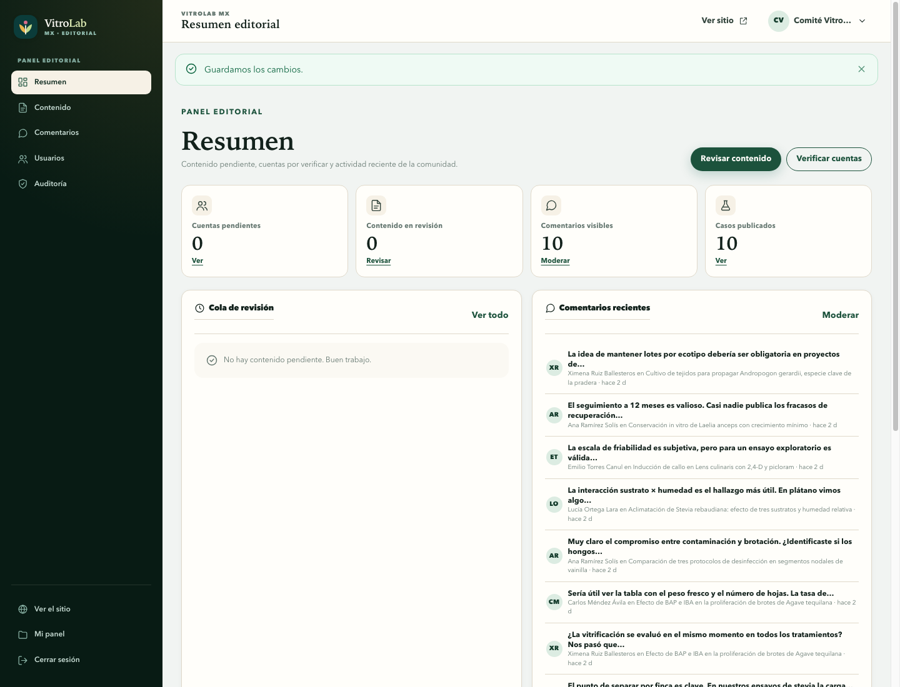 | 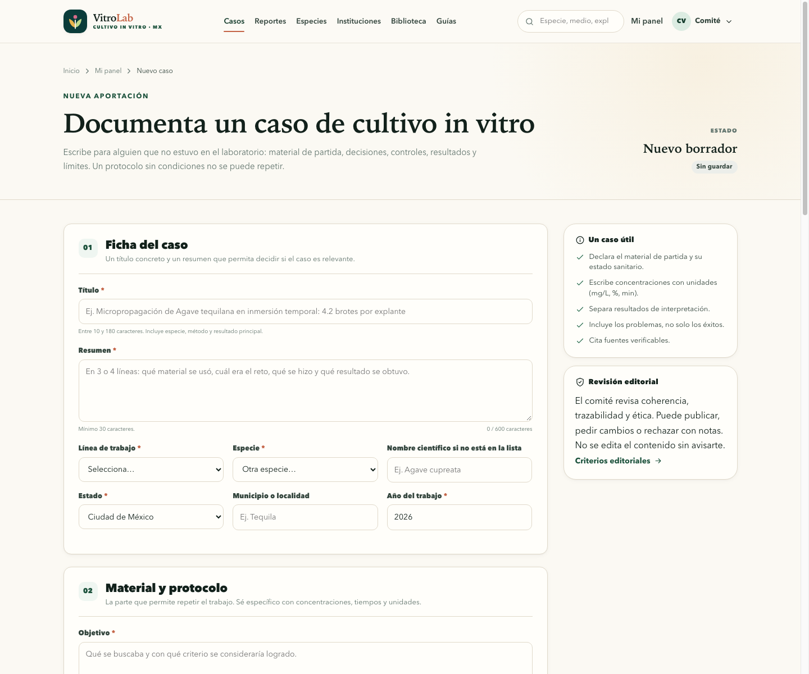 |

## Funcionalidades

### Comunidad

- Registro como estudiante, docente, investigador o técnico de laboratorio.
- Verificación automática por dominio institucional o manual con constancia.
- Perfil público con institución, formación, semblanza, ORCID y publicaciones.
- Comentarios, reacciones, favoritos y panel personal con estado editorial.

### Casos de cultivo in vitro

- Ficha técnica con especie, familia, explante, desinfección, medio, PGR y condiciones.
- Protocolo paso a paso y galería de hasta cuatro imágenes.
- Métricas: contaminación, supervivencia, multiplicación, enraizamiento y aclimatación.
- Búsqueda full-text en español y filtros por línea, especie, estado y año.
- Descarga en PDF con folio, autoría, licencia y cita sugerida.
- Vinculación con los reportes que se derivaron del caso.

### Reportes de laboratorio

- Tipos: ensayo, protocolo, diagnóstico, seguimiento, validación y conjunto de datos.
- Diseño experimental, hipótesis, tratamientos, tamaño de muestra y variables.
- Tabla estructurada de tratamientos con respuesta y unidad.
- Figuras, CSV, XLSX, PDF y DOCX como anexos descargables.
- Gráfica comparativa generada a partir de la tabla.
- Descarga en PDF con tabla de tratamientos y cita sugerida.

### Curaduría y comunidad

- Directorio de especies con familia, nombre común y documentos asociados.
- Directorio de instituciones agrupado por estado, con miembros y publicaciones.
- Biblioteca con repositorios de GitHub, datasets de Hugging Face, manuales y artículos.
- Glosario operativo de cultivo de tejidos vegetales.
- Comité editorial con cola de revisión, decisiones, destacados y auditoría.

### Infraestructura

- PHP 8.2+ sin Composer ni frameworks.
- PostgreSQL 15+ en Neon con `pg_trgm`, `citext` y `tsvector`.
- Conexión por `pdo_pgsql` (TLS) o por el endpoint SQL HTTPS de Neon.
- CSS propio, JavaScript sin dependencias y diseño responsive.
- CSRF, `password_hash`, cookies `HttpOnly`/`SameSite`, validación de archivos y límite de intentos.
- Migraciones y seeds por CLI, nunca desde el navegador.

## Stack

| Capa | Tecnología |
| --- | --- |
| Lenguaje | PHP 8.2+ con `declare(strict_types=1)` |
| Base de datos | PostgreSQL 15+ en Neon; `pg_trgm`, `citext`, `tsvector` |
| Acceso a datos | `pdo_pgsql` o endpoint SQL HTTPS |
| Servidor | Apache/LiteSpeed en Hostinger; `php -S` en local |
| Frontend | HTML semántico, CSS propio, JavaScript sin dependencias |
| PDF | Generador propio sobre fuentes Helvetica, sin librerías externas |
| Imágenes | Pillow (script de generación de portadas y figuras) |
| Correo | `mail()` de PHP, opcional con `MAIL_ENABLED=true` |

## Arquitectura

```text
Navegador
   │ HTTPS
   ▼
Hostinger · public_html
   ├─ .htaccess              redirige a public/ y bloquea rutas sensibles
   ├─ public/index.php       front controller
   ├─ app/Core               router, request, sesión, CSRF, BD, vistas
   ├─ app/Controllers        casos, reportes, especies, instituciones, cuenta, admin
   ├─ app/Repositories       SQL parametrizado por dominio
   ├─ app/Services           verificación institucional
   ├─ app/Views              plantillas PHP con layouts
   └─ database/              migraciones y seeds
          │
          └─ pdo_pgsql (TLS) ──► Neon PostgreSQL
```

- Sin ORM: consultas SQL con marcadores `$1, $2, …` y repositorios.
- Sin Composer: autoloader mínimo para `App\`.
- Migraciones y seeds se ejecutan por CLI.
- La verificación vive en `app/Services/MemberVerifier.php`.

## Modelo de datos

| Tabla | Propósito |
| --- | --- |
| `users` | Cuenta, rol, estado, institución, formación, ORCID, matrícula privada y método de verificación. |
| `cases` | Caso con especie, explante, desinfección, medio, PGR, condiciones, protocolo, resultados y métricas. |
| `case_images` | Imágenes del caso. |
| `reports` | Reporte con tipo, diseño, tratamientos, variables, análisis, conclusiones y limitaciones. |
| `report_treatments` | Tabla estructurada de tratamientos, n, respuesta, unidad y notas. |
| `report_files` | Figuras, datos y documentos anexos. |
| `species` | Catálogo de especies con familia, nombre común y grupo. |
| `institutions` | Universidades, centros, institutos, laboratorios y jardines botánicos. |
| `comments`, `reactions`, `bookmarks` | Discusión, reacciones y favoritos por tipo de contenido. |
| `reviews` | Decisiones editoriales e historial. |
| `categories`, `states` | Líneas de trabajo y entidades federativas. |
| `audit_log`, `login_attempts`, `password_resets` | Auditoría, seguridad y recuperación. |

Las migraciones están en [`database/migrations`](database/migrations) y los catálogos en [`database/seeds`](database/seeds).

## Inicio rápido local

### Requisitos

- PHP 8.2+ con `pdo_pgsql`, `curl`, `mbstring`, `fileinfo`, `gd`, `intl` y `zip`.
- PostgreSQL 15+ o una base Neon.
- `psql` opcional.

```bash
cp .env.example .env
# Edita DATABASE_URL, APP_URL y APP_KEY
php bin/migrate.php
php bin/seed.php
php bin/create-admin.php \
  --name="Comité Editorial" \
  --email="admin@tu-dominio.mx" \
  --password="UnaClaveLargaYUnica" \
  --state=CMX
php -S 127.0.0.1:8085 -t public bin/router.php
```

Abre <http://127.0.0.1:8085>.

### Verificación

```bash
php bin/check.php
```

Comprueba extensiones, permisos, conexión, migraciones y conteos.

### Cuentas demostrativas

`php bin/seed.php` crea ocho cuentas de ejemplo con la contraseña `DemoVitro2026!`:

| Correo | Perfil |
| --- | --- |
| `ana.ramirez@colpos.mx` | Estudiante, COLPOS |
| `carlos.mendez@chapingo.mx` | Estudiante, UACh |
| `lucia.ortega@uanl.mx` | Estudiante, UANL |
| `diego.sanchez@udg.mx` | Estudiante, UdeG |
| `mariana.lopez@buap.mx` | Estudiante, BUAP |
| `emilio.torres@uady.mx` | Estudiante, UADY |
| `ximena.ruiz@uv.mx` | Estudiante, UV |
| `ricardo.salas@colpos.mx` | Docente y editor |

**Cámbialas o elimínalas en producción.** El administrador se crea con `bin/create-admin.php`; no se siembra por defecto.

## Imágenes y figuras

Las portadas de los casos, el logo y las figuras de los reportes se generan localmente con Pillow. No se descargan fotos de terceros.

```bash
python3 tools/generar_imagenes.py
```

Salidas: `public/assets/img/`, `public/uploads/casos/demo/` y `public/uploads/archivos/demo/`.

## Despliegue en Hostinger

La guía completa está en [`docs/DESPLIEGUE-HOSTINGER.md`](docs/DESPLIEGUE-HOSTINGER.md). Resumen:

1. Subir el proyecto a `public_html` (el `.htaccess` raíz redirige a `public/`).
2. Crear `.env` de producción con `APP_URL` y `DATABASE_URL` (Neon directo + `options=endpoint%3D…`).
3. `chmod 600 .env`; `storage/` y `public/uploads/` escribibles.
4. Ejecutar migraciones y seeds desde local o por SSH.
5. Probar `/salud`, registro, publicación, subida de anexos y PDF.

## Seguridad

- Contraseñas con `PASSWORD_DEFAULT` (bcrypt/Argon2 según PHP).
- CSRF en todos los formularios y acciones POST.
- Cookies de sesión `HttpOnly`, `SameSite=Lax` y `Secure` en HTTPS.
- Validación de MIME real, tamaño y dimensiones de imágenes; documentos con lista blanca.
- `.htaccess` bloquea `app/`, `config/`, `database/`, `storage/`, `.env` y ejecución de PHP en uploads.
- Intentos de acceso limitados por correo e IP.
- Auditoría de acciones editoriales y de cuenta.
- Constancias privadas fuera del árbol público, servidas sólo a administradores.

> **Credenciales.** Rota la contraseña de Neon y la del administrador después de la puesta en marcha. No publiques `.env` ni cadenas de conexión en el repositorio.

## Fuentes y método

La biblioteca inicial se construyó con repositorios y datasets públicos relacionados con cultivo de tejidos, micropropagación y fenotipado in vitro, además de manuales y literatura científica. Incluye, entre otros:

- `avahoffman/tissue-culture-andropogon`, `BigPhenomics/GMOnotebook`, `NPEC-NL/hades-research-resources` y `virtual-labs/exp-plant-tissue-culture-au`.
- Datasets de Hugging Face como `Kquant03/Caduceus-Dataset` y `parthrautV/agri_data`.
- Murashige y Skoog (1962), George, Hall y De Klerk (2008), Bhojwani y Dantu (2013) y Loyola-Vargas y Ochoa-Alejo (2018).

La curaduría completa, con enlaces, está en [`/biblioteca`](https://lightcoral-hare-545659.hostingersite.com/biblioteca) y en [`app/Controllers/PageController.php`](app/Controllers/PageController.php).

## Licencia

Código bajo licencia MIT. El contenido publicado por los autores se rige por la licencia que cada publicación declare (por defecto `CC BY-NC-SA 4.0`).

Hecho en México · Español · 2026.
